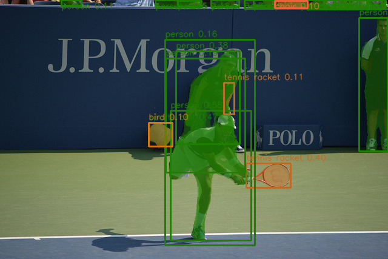
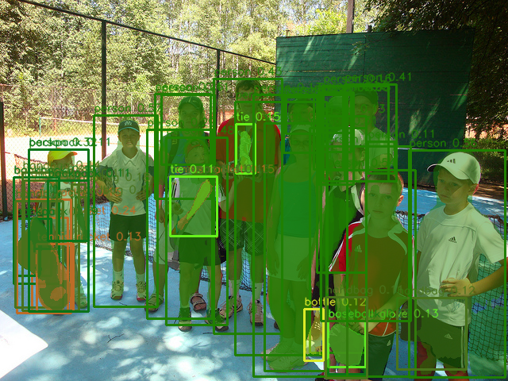
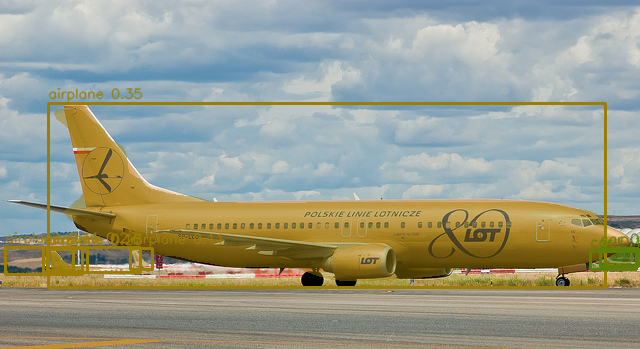
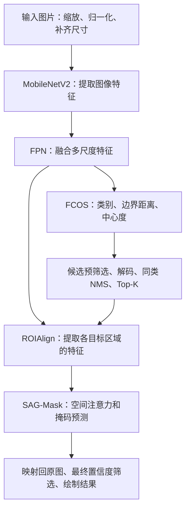

# Week8：CenterMask 实例分割进阶实验部署与任务关键点

本次按照 [实例分割进阶实验.pptx](./实例分割进阶实验.pptx) 完成了环境搭建、预训练模型推理和置信度阈值实验。在当前 Apple Silicon / macOS 机器上使用 **CPU** 实际运行原始 CenterMask-Lite，生成了 **3 张测试图 × 3 个阈值 = 9 张结果图**，并记录检测数量、类别、实例掩码和推理耗时。

## 1. 课件要求与交付内容

课件第二页列出三个任务；第一页介绍原项目目录及训练、推理流程。本次实验使用预训练权重，课件没有要求重新训练。

| 课件要求 | 本次完成内容 |
| --- | --- |
| 任务一：环境搭建 | 独立 `.venv`、固定依赖版本、`uv.lock`、旧版 PyTorch 接口适配、CPU 推理算子适配 |
| 下载预训练模型并给出链接 | 官方 Google Drive 的原始 CenterMask-Lite / MobileNetV2 / 1x 权重；下载脚本校验大小与 SHA256 |
| 准备 3–5 张测试图片 | 使用项目自带的三张 COCO 图片：网球运动员、多人合影、飞机 |
| 运行推理并保存至少 3 张输出图片 | 三种阈值各保存三张带框、类别、分数和掩码的图片，共九张 |
| 运行命令截图 | [命令与输出截图](./results/experiment/command_output.png)，内容来自实际执行日志的浏览器截图；[原始日志](./results/experiment/run.log) 可核对 |
| 推理耗时记录 | [metrics.csv](./results/experiment/metrics.csv)，每个图片/阈值组合重复三次并取平均 |
| 参数实验：`--conf_th 0.1 / 0.5 / 0.9` | 支持单阈值和一次执行三个阈值，记录数量变化并分析漏检、误检及阈值选择 |

直接打开 [结果展示页](./results/experiment/index.html) 可查看命令记录和九张对比图；也可查看 [完整实验截图](./results/experiment/experiment_overview.png)。截图展示真实日志页面，不是操作系统终端窗口截图。

## 2. 已部署环境与复现方法

### 2.1 运行环境

| 项目 | 本次实际环境 |
| --- | --- |
| 系统 / 架构 | macOS / arm64 |
| Python | 3.11.13 |
| PyTorch / torchvision | 2.5.1 / 0.20.1 |
| NumPy / Pillow | 1.26.4 / 11.0.0 |
| OpenCV | opencv-python-headless 4.10.0.84 |
| 推理设备 | CPU，4 个 PyTorch 线程；本机没有 CUDA |
| 输入分辨率 | 短边 600、长边不超过 1000；与所选配置一致 |
| 模型 | 原始 CenterMask-Lite，MobileNetV2 + FPN + FCOS + SAG-Mask，1x 权重 |

依赖见 [pyproject.toml](./pyproject.toml)，完整解析版本见 [uv.lock](./uv.lock)。环境和模型权重不纳入 Git；权重已经下载到本地 `weights/`，可以通过脚本重新下载。

### 2.2 部署与运行命令

从仓库根目录进入本目录，执行：

```bash
cd Week8
uv sync --frozen
uv run --frozen download_weights.py
uv run --frozen CenterMask-master/demo/week8_experiment.py \
  --thresholds 0.1 0.5 0.9 \
  --limit 3 --device cpu --warmup 1 --repeats 3
```

本次下载使用了本机已配置的 HTTP 代理。下载脚本默认读取系统 HTTPS 代理；如网络需要显式代理，可添加 `--proxy http://127.0.0.1:7897`。其他机器应填写自己的代理地址，能够直连时无需此参数。已有权重会先核对校验值，无需重复下载。

按课件逐项运行单阈值：

```bash
uv run --frozen CenterMask-master/demo/week8_experiment.py --conf_th 0.1 --output_dir results/conf_0.1
uv run --frozen CenterMask-master/demo/week8_experiment.py --conf_th 0.5 --output_dir results/conf_0.5
uv run --frozen CenterMask-master/demo/week8_experiment.py --conf_th 0.9 --output_dir results/conf_0.9
```

默认输入为项目自带图片，默认只取文件名排序后的前三张。处理自己的图片或整个目录：

```bash
uv run --frozen CenterMask-master/demo/week8_experiment.py \
  --input /absolute/path/to/images --limit 0 \
  --conf_th 0.1 --output_dir results/custom
```

`--limit 0` 表示处理全部图片。`--weights`、`--config-file` 可指定其他相互匹配的原始 CenterMask 权重和配置。本次验证覆盖所选非 DCN 的 MobileNetV2-Lite CPU 推理；CUDA 路径、DCN 模型及训练不在此次实测范围内。

### 2.3 预训练权重来源

- [原始 CenterMask 官方仓库](https://github.com/youngwanLEE/CenterMask)
- [官方模型目录](https://drive.google.com/drive/folders/1llkxG5lKK7lZZ0W__7u5M5m4Ddf4YIWr)
- [本次模型的官方文件页](https://drive.google.com/file/d/1okKyI9rYahM_OIKVRtTf7u_cqbLU4KSW/view)
- [直接下载地址](https://drive.usercontent.google.com/download?id=1okKyI9rYahM_OIKVRtTf7u_cqbLU4KSW&export=download&confirm=t)

文件：`centermask-lite-M-v2-ms-bs32-1x.pth`，大小 **29,604,748 字节**。

SHA256：`b3b2490756cb8c3c866c0a39ec44bf40c28f1c39a6d22c11995be2e4be54eac2`。

匹配配置：[centermask_M_v2_FPN_lite_res600_ms_bs32_1x.yaml](./CenterMask-master/configs/centermask/centermask_M_v2_FPN_lite_res600_ms_bs32_1x.yaml)。官方 Dropbox 的部分旧链接已经失效，本次采用仍可下载的官方 Google Drive 1x 模型。

## 3. 实测结果与参数分析

下表来自 [metrics.csv](./results/experiment/metrics.csv)。耗时单位为 ms，每个组合均重新运行三次推理并取平均；首次预热一次，模型加载时间单独记录。

| 图片与场景 | 阈值 0.1：框数 / 耗时 | 阈值 0.5：框数 / 耗时 | 阈值 0.9：框数 / 耗时 |
| --- | ---: | ---: | ---: |
| `000000000885`：网球运动员 | 23 / 165.06 | 2 / 162.19 | 0 / 167.34 |
| `000000001000`：多人合影 | 50 / 151.03 | 3 / 147.61 | 0 / 146.93 |
| `000000005477`：飞机 | 8 / 182.19 | 0 / 171.57 | 0 / 174.42 |
| 合计检测框 | **81** | **5** | **0** |

计时包含预处理、网络前向、FCOS 输出有限值检查、检测后处理、结果回传 CPU 和掩码投影；不包含读图、绘图和写文件。CPU 耗时约为每张 **147–182 ms**，不可与论文中 NVIDIA GPU 的速度直接比较。阈值筛选在网络前向及掩码计算后执行，因此提高显示阈值不会显著减少此次测量的推理时间。

### 3.1 漏检和误检现象

以下为对原图和输出图的人工定性观察。没有使用人工标注文件计算 COCO AP、精确率或召回率。

- **0.1：保留目标较多，也明显引入重复框和误检。** 网球场图片中出现多个背景人物候选，以及可疑的 `bird`、`chair` 类别；合影中出现重复的人体框和大量可疑的 `handbag` 候选。飞机主目标被保留，最高分约为 0.35，同时存在多个背景飞机和车辆候选。合影达到配置中的 `TEST.DETECTIONS_PER_IMG=50` 上限，因此数量受到 Top-K 限制。
- **0.5：画面更干净，但漏检明显增加。** 网球场只保留两个人；合影只保留三个人，遗漏多名可见人物；飞机图没有结果，主飞机也被过滤。
- **0.9：三张图均没有保留结果。** 本次样例的有效预测分数低于此阈值，不能据此认为模型没有执行，也不代表高阈值的结果更好。

**在课件指定的三个候选阈值中，本次选择 0.1 作为演示阈值**，因为三种场景的主要目标仍被保留。代价是误检与重复框较多；0.5 可用于偏重少量高置信目标的展示，0.9 不适合这组图片。此选择只针对本次模型和样例，不能代替带标注验证集上的阈值优化。

### 3.2 可直接提交的三张推理结果







## 4. 此次任务的关键点

### 4.1 识别正确的 CenterMask 版本与模型配置

本项目基于 `maskrcnn_benchmark` 和 FCOS，属于原始 CenterMask，实现不能直接套用基于 Detectron2 的 CenterMask2 安装方式。权重必须和骨干、FPN 通道数、FCOS 层数、SAG-Mask 结构相匹配。本次以 `strict=True` 加载所有模型参数；缺失或多余的实际模型参数会报错，避免静默使用随机初始化的分支。

### 4.2 适配当前硬件与历史依赖

原项目面向 PyTorch 1.1 / CUDA 10.0，包含旧 C++/CUDA 算子。本次使用 torchvision 的预编译 NMS、分组 NMS 和 ROIAlign 完成非 DCN 模型的推理，保持原始网络结构与预训练权重。

- NMS 保留原始框的闭区间像素语义，即宽高中的 `+1`；否则小目标的重叠率和保留框会改变。
- ROIAlign 使用 `aligned=False`，与原始坐标约定一致。
- 原有编译扩展存在时，Python 仍优先加载扩展；新增的 `_C.py` 用于未编译扩展的环境。
- CPU 适配仅覆盖此次推理所需算子。训练反向和可变形卷积仍需要原始扩展，不能把成功推理等同于完成训练环境部署。

### 4.3 处理数值问题，不能只判断程序是否退出成功

部署中实际遇到：权重加载成功，但所有图的检测结果均为零。通过运行时前向钩子检查，发现官方 MobileNetV2 权重部分 `running_var` 约为 **−1.413 × 10⁻¹²**。原冻结 BatchNorm 直接计算 `running_var.rsqrt()`，使第一组倒残差块产生 NaN，随后所有 FCOS 输出变为 NaN，最终被阈值过滤成空结果。

修复方式是在 MobileNetV2 的冻结 BatchNorm 中使用 `eps=1e-5`：

$$
\operatorname{scale}=\gamma\,(\operatorname{running\_var}+\varepsilon)^{-1/2},\qquad \varepsilon=10^{-5}.
$$

同时允许加载 BatchNorm 中对冻结统计无用的 `num_batches_tracked`。其他骨干的默认 epsilon 保持原值。新增检查确保非有限 FCOS 输出直接报错，防止把 NaN 误当成“正常的零检测”。

### 4.4 区分置信度阈值、掩码阈值和 NMS 阈值

`--conf_th` 筛选的是整实例的预测分数，而不是掩码像素。所选模型的 FCOS 分数为分类概率和中心度概率的乘积：

$$
s=\sigma(z_{\mathrm{class}})\,\sigma(z_{\mathrm{centerness}}).
$$

原实现没有对该乘积开平方，因此不能照搬其他实现的置信度经验值。本次按 `score > conf_th` 保留实例；如果另一个配置启用了 `mask_scores`，会按该字段筛选。

- `MODEL.FCOS.INFERENCE_TH=0.03`：FCOS 内部候选预筛选阈值。
- `--conf_th`：本实验的最终实例展示阈值。
- `Masker` 的 0.5：每个实例内部的掩码二值化阈值。
- `MODEL.FCOS.NMS_TH`：用于抑制重叠候选框，与上述两种阈值用途不同。

实验保持分辨率、权重、模型配置、NMS 和 Top-K 设置一致，仅改变最终实例展示阈值，保证比较有意义。

### 4.5 保留完整的实验依据

每张可视化图都有对应 JSON，保存框坐标、类别、分数以及 COCO RLE 掩码，可以重新读取掩码。额外保存解析后的配置、环境版本、权重校验值、实际命令、每次重复的耗时和 CSV 汇总。

### 4.6 各模块如何实现检测和实例分割



| 模块 | 在本次模型中的作用 |
| --- | --- |
| MobileNetV2 | 用倒残差块和深度可分离卷积提取纹理、轮廓和语义特征，同时控制计算量。此次配置选用它作为骨干，未使用项目中的 ResNet 或 VoVNet。 |
| FPN | 融合不同分辨率的特征，输出五级特征图，让小目标和大目标使用适合自身尺度的信息。 |
| FCOS | 在特征图的每个位置预测 80 类概率、到框四条边的距离和中心度，不需要预先设置锚框。位置为 $(x,y)$，距离为 $(l,t,r,b)$ 时，解码为框 $(x-l,y-t,x+r,y+b)$。 |
| 后处理 | 预筛候选、解码坐标；同一类别的重叠框通过 NMS 去重，并按配置限制最多保留 50 个候选实例。最终展示阈值在掩码推理后应用。 |
| ROIAlign | 根据 FCOS 输出的框从 FPN 取对应区域，通过插值得到固定的 $14\times14$ 特征，保留目标边缘的位置信息。 |
| SAG-Mask | 对区域特征沿通道求平均值和最大值，拼接后经过卷积、Sigmoid 得到空间注意力，再与原特征相乘。掩码预测器将结果上采样为 $28\times28$ 的类别掩码。 |
| Masker 与绘图 | 选出该实例所属类别的掩码，将像素概率按 0.5 二值化并投影回原图，叠加半透明颜色、框、类别和分数。不同人的掩码分别保存，因此可以区分同一类别中的多个实例。 |

类别、框和掩码的识别能力来自官方 COCO 预训练权重；本次加载权重进行推理，没有重新训练。FCOS 完成目标检测，SAG-Mask 在每个检测目标内部继续判断哪些像素属于该目标。

工程依赖方面，PyTorch 执行网络，torchvision 提供预编译 NMS/ROIAlign，OpenCV、Pillow 和 NumPy 处理图像，YACS 管理 YAML 配置，pycocotools 编解码实例掩码，pytest 验证行为，uv 固定和恢复运行环境。

## 5. 实现位置与验证

| 文件 | 用途 |
| --- | --- |
| [download_weights.py](./download_weights.py) | 官方权重下载、原子写入、大小和 SHA256 校验 |
| [demo/week8_experiment.py](./CenterMask-master/demo/week8_experiment.py) | 单阈值/多阈值推理，计时、绘图、JSON/CSV、环境与日志记录、HTML 展示 |
| [demo/predictor.py](./CenterMask-master/demo/predictor.py) | 增加严格权重加载，修复模型返回空列表时的越界 |
| [maskrcnn_benchmark/_C.py](./CenterMask-master/maskrcnn_benchmark/_C.py) | NMS 与 ROIAlign 前向的 torchvision 适配 |
| [layers/batch_norm.py](./CenterMask-master/maskrcnn_benchmark/layers/batch_norm.py)、[backbone/mobilenet.py](./CenterMask-master/maskrcnn_benchmark/modeling/backbone/mobilenet.py) | 加载冻结 BatchNorm 的无用计数器，处理 MobileNetV2 数值稳定性 |
| [fcos/inference.py](./CenterMask-master/maskrcnn_benchmark/modeling/rpn/fcos/inference.py) | 以 `reshape` 处理现代 PyTorch 的非连续候选张量 |
| [utils/imports.py](./CenterMask-master/maskrcnn_benchmark/utils/imports.py)、[utils/c2_model_loading.py](./CenterMask-master/maskrcnn_benchmark/utils/c2_model_loading.py)、[utils/model_zoo.py](./CenterMask-master/maskrcnn_benchmark/utils/model_zoo.py) | 替换已移除的 `torch._six` 与私有下载接口 |
| [test_week8_inference.py](./CenterMask-master/tests/test_week8_inference.py) | 针对本次新增行为及修复的回归测试 |

在本目录执行：

```bash
uv run --frozen -m pytest -q
```

实测 **16 passed**，包含新回归测试和项目原有 CPU NMS 测试。覆盖像素坐标兼容、跨类别抑制、ROIAlign 坐标、非连续 FCOS 候选、空检测、严格权重加载、冻结 BatchNorm 数值稳定性、阈值边界、掩码 RLE 编解码及 NaN 拦截。第三方库有弃用提示，不影响上述测试与推理完成。

## 6. 结果文件索引

- [index.html](./results/experiment/index.html)：实验浏览页。
- [command_output.png](./results/experiment/command_output.png)：实际命令与输出记录的页面截图。
- [experiment_overview.png](./results/experiment/experiment_overview.png)：完整实验结果截图。
- [metrics.csv](./results/experiment/metrics.csv)：九个组合的框数、平均耗时及类别数量。
- [environment.json](./results/experiment/environment.json)：运行环境、权重 SHA256、命令和计时范围。
- [resolved_config.yaml](./results/experiment/resolved_config.yaml)：运行时最终配置。
- [run.log](./results/experiment/run.log)：实际标准输出日志。
- [validation.json](./results/experiment/validation.json)：结果数量、阈值单调性、掩码编解码、截图和权重完整性检查记录。
- [threshold_0.1/](./results/experiment/threshold_0.1/)、[threshold_0.5/](./results/experiment/threshold_0.5/)、[threshold_0.9/](./results/experiment/threshold_0.9/)：各阈值下的图片及对应实例 JSON。
