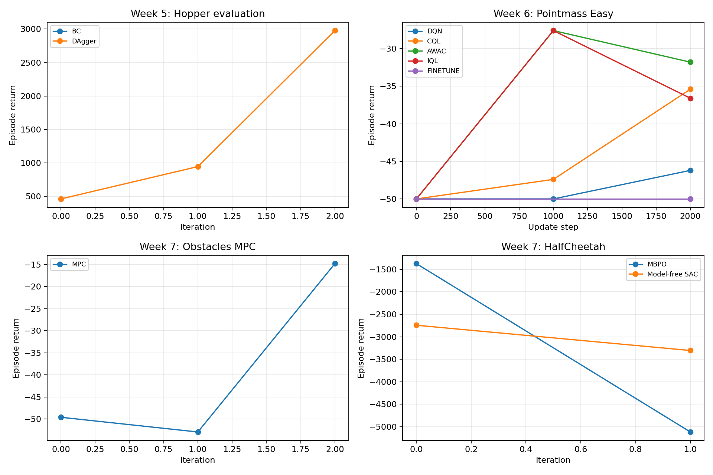

# Week5–7 缩短训练结果（2026-11-03）

本报告记录在 Windows、Python 3.10.18、RTX 4060 Laptop GPU 上，用 uv 和随机种子 1 完成的**小规模流程验证**。曲线来自 TensorBoard 事件文件，原始标量保存在 [metrics.json](metrics.json)；图和指标可在仓库根目录运行 `uv run --project Week6 --frozen --offline python results/week5-7/build_results.py` 重新生成。脚本也会检查所有导出的权重能由 `torch.load(weights_only=True)` 加载，且张量均为有限值。

## Week5：Hopper 模仿学习

使用提供的 2 条、共 2000 步专家轨迹（平均回报 3717.51）。BC 训练 500 次更新；DAgger 训练 3 轮，每轮 500 次更新，第 1、2 轮各采集约 1000 步学生轨迹并由专家重新标注。每次评估至少采集 1000 环境步。

| 方法 | 轮次 0 | 轮次 1 | 轮次 2 |
| --- | ---: | ---: | ---: |
| BC 评估平均回报 | 462.34 | — | — |
| DAgger 评估平均回报 | 462.34 | 946.00 | 2978.26 |

最后一轮 DAgger 回报高于 BC，但仍低于这批专家轨迹的均值。评估回合数量有限，不能据此推断多种随机种子下的稳定效果。导出的 BC 和 DAgger 权重在 [checkpoints/](checkpoints/) 中。

## Week6：Pointmass Easy

RND 探索采集 3000 步，保存了本地数据集和覆盖图。DQN、CQL、AWAC、IQL 均使用这同一数据集，各完成 3000 次离线更新。DQN 微调额外完成 1000 次离线更新与 2000 次在线更新。每个记录点使用 5 条评估轨迹；表中最后一个点位于第 2000 步，训练继续到第 3000 步。

| 流程 | 第 0 步 | 第 1000 步 | 第 2000 步 |
| --- | ---: | ---: | ---: |
| RND 探索策略 | -50.0 | -31.4 | -19.6 |
| 离线 DQN | -50.0 | -50.0 | -46.2 |
| 离线 CQL | -50.0 | -47.4 | -35.4 |
| 离线 AWAC | -50.0 | -27.6 | -31.8 |
| 离线 IQL | -50.0 | -27.6 | -36.6 |
| DQN 离线到在线微调 | -50.0 | — | -50.0 |

回报越高越好。这里的微调没有显示收益，四种离线算法的排序也可能随数据和种子变化。原课件配置为 100000 次离线更新；这些 3000 次更新的结果只能用于验证训练路径和观察初期趋势。数据集、原始事件日志及覆盖图保留在本机的 `Week6/datasets/`、`Week6/data/`、`Week6/exploration_visualization/`，仓库提交的是指标、概览图与权重。

## Week7：模型规划及 SAC

Obstacles MPC 使用 [配置](../../Week7/experiments/mpc/obstacles_pilot.yaml)：初始采集 1000 步，随后两轮各 200 步；每轮训练 3 个动力学模型，各 40 次更新。规划时域为 5，候选动作序列 64 条。HalfCheetah 的 MBPO 与无模型 SAC 使用 [共享环境配置](../../Week7/experiments/mpc/halfcheetah_pilot.yaml)，每轮 100 次 SAC 更新；MBPO 额外训练动力学模型并采用长度 1 的模型轨迹。每个点仅评估 2 条轨迹。

| 流程 | 轮次 0 | 轮次 1 | 轮次 2 |
| --- | ---: | ---: | ---: |
| Obstacles MPC | -49.62 | -52.95 | -14.80 |
| HalfCheetah MBPO | -1374.64 | -5114.96 | — |
| HalfCheetah 无模型 SAC | -2743.63 | -3304.55 | — |

Obstacles 的回报在最后一轮提高，平均动力学损失从约 0.29 降至 0.10。HalfCheetah 的两个 SAC 试验都没有在这段短训练中改善，不能据此比较 MBPO 与无模型 SAC 的长期表现。最终模型权重见 [checkpoints/](checkpoints/)；[build_results.py](build_results.py) 对所有权重执行了加载及有限值检查。

## 复现与范围

- Week5：在 `Week5/imitation_learning` 运行 `uv run --frozen --offline python cs285/scripts/run_hw1.py`，使用 `--env_name Hopper-v4`、`--expert_data cs285/expert_data/expert_data_Hopper-v4.pkl`、`--num_agent_train_steps_per_iter 500`、`--eval_batch_size 1000` 和 `--save_params`；DAgger 另加 `--expert_policy_file cs285/policies/experts/Hopper.pkl --do_dagger --n_iter 3 --batch_size 1000`。专家数据与策略文件需要在本地提供。
- Week6：在 `Week6` 运行探索、离线训练和微调脚本；均使用 `--frozen --offline`，通过 `--set` 将 `total_steps` 或 `training_steps` 改为 3000，并将 `dataset_name` 设为 `pointmass_easy_rnd_pilot`。离线训练使用 `--eval_interval 1000 --num_eval_trajectories 5`；微调使用 `offline_steps=1000`。
- Week7：在 `Week7` 运行 `uv run --frozen --offline python cs285/scripts/run_hw4.py --config_file experiments/mpc/obstacles_pilot.yaml`。HalfCheetah 将 `--config_file` 改为 `experiments/mpc/halfcheetah_pilot.yaml`，另选 `--sac_config_file experiments/sac/halfcheetah_mbpo_pilot.yaml` 或 `experiments/sac/halfcheetah_model_free_pilot.yaml`。

Week5 的 BeyondMimic 需要另装 Isaac Sim、Isaac Lab 及机器人资源，本机没有完成这部分训练。图中同一面板只比较同一环境的回报；不同环境间不能直接比较数值。
