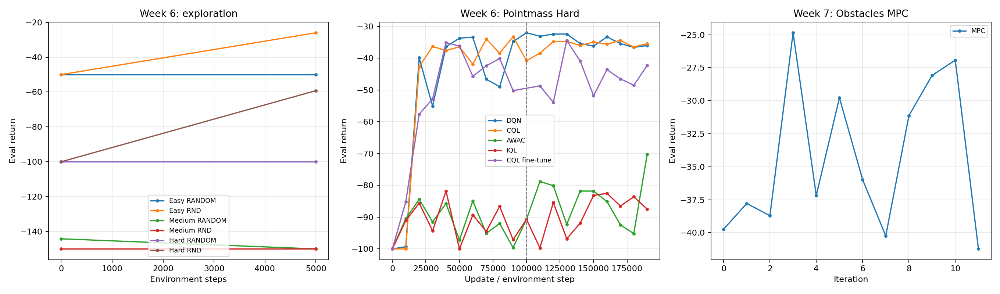

# Week 6–7 完整配置训练结果

2026-11-03 在本机使用 uv 跑完 Week 6 Pointmass 数据采集、Hard 离线训练和 CQL 微调，以及 Week 7 Obstacles 的 12 轮 MPC。这里保存评估曲线、TensorBoard 标量摘录、最终模型和训练数据。数据来自一次运行，不能当作多种子统计结论。



## Week 6

Easy、Medium、Hard 各用 Random 和 RND 采集 10,000 环境步。完整数据位于 [`datasets/`](datasets/)，文件大小与 SHA-256 见 [`metrics.json`](metrics.json)。下表是第 5,000 步的最后一次评估回报；评估间隔为 5,000 步。

| 环境 | Random | RND |
| --- | ---: | ---: |
| Easy | -50.0 | -26.0 |
| Medium | -150.0 | -150.0 |
| Hard | -100.0 | -59.2 |

在 Pointmass Hard 的 RND 数据上，各离线算法按相应配置运行 200,000 更新步。CQL 微调另运行 100,000 离线更新步和 100,000 在线步。下表为第 190,000 步的最后一次评估，评估间隔为 10,000 步，每次 10 条轨迹。

| 算法 | 最后一次评估回报 | 运行中最高评估回报 |
| --- | ---: | ---: |
| DQN | -36.0 | -32.0 |
| CQL | -35.4 | -33.2 |
| AWAC | -70.2 | -70.2 |
| IQL | -87.5 | -81.8 |
| CQL 离线预训练后在线微调 | -42.3 | -34.4 |

这组单次运行中，DQN 和 CQL 的末次评估优于 AWAC 和 IQL。CQL 在线微调未超过独立 CQL 训练的末次评估；两者使用的 CQL 系数和训练流程不同，不能把差异直接归因于在线微调。

## Week 7

Obstacles MPC 使用 [`obstacles_multi_iter.yaml`](../../../Week7/experiments/mpc/obstacles_multi_iter.yaml) 的原始 12 轮配置：初始采集 5,000 步、后续每轮 1,000 步、每轮 20 次动力学更新和 20 条评估轨迹。第 11 轮的末次评估回报为 **-41.23**；第 3 轮最好，为 **-24.85**。后续评估波动明显，最终权重不一定对应最优轮次。

## 复现与校验

[`build_results.py`](build_results.py) 读取原始 TensorBoard 事件、校验评估点数量和模型张量有限值，导出 [`metrics.json`](metrics.json)、[`overview.png`](overview.png)、[`checkpoints/`](checkpoints/) 与 [`datasets/`](datasets/)。导出文件附 SHA-256 与字节数。脚本从仓库根目录运行：

```powershell
uv run --project Week6 --frozen --no-sync --offline python results/week6-7/full/build_results.py
```

上述命令使用已有的 Week 6 虚拟环境。新机器先按 [`Week6/README.md`](../../../Week6/README.md) 配好环境；安装依赖时使用国内 PyPI 镜像。要重跑训练，先将 [`datasets/`](datasets/) 中的 `.pkl` 文件复制到 `Week6/datasets/`，然后在 `Week6` 目录中依次执行相应配置：

```powershell
uv run --frozen --no-sync --offline python cs285/scripts/run_hw5_offline.py --cfg experiments/offline/pointmass_hard_cql.yaml --dataset_dir datasets --eval_interval 10000 --num_eval_trajectories 10 --log_interval 500
uv run --frozen --no-sync --offline python cs285/scripts/run_hw5_finetune.py --cfg experiments/finetuning/pointmass_hard_cql_finetune.yaml --dataset_dir datasets --eval_interval 10000 --num_eval_trajectories 10 --visualize_interval 10000 --log_interval 500
```

将第一条命令的配置名替换为 `pointmass_hard_dqn.yaml`、`pointmass_hard_awac.yaml` 或 `pointmass_hard_iql.yaml` 可运行其他离线算法。Week 7 在 `Week7` 目录中运行：

```powershell
uv run --frozen --no-sync --offline python cs285/scripts/run_hw4.py --config_file experiments/mpc/obstacles_multi_iter.yaml
```

模型文件是本机训练产物。PyTorch 权重及 pickle 数据应只从可信来源加载；这里的校验确认文件完整、张量有限，但不代替在其他机器上的重复训练或独立评估。
